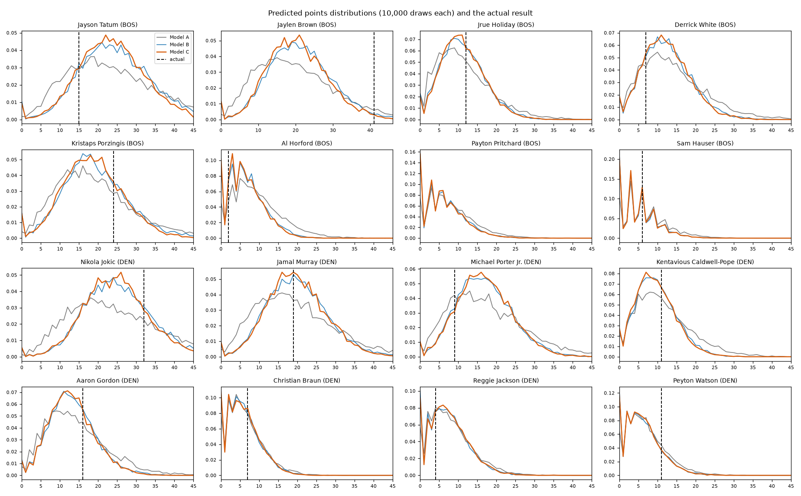
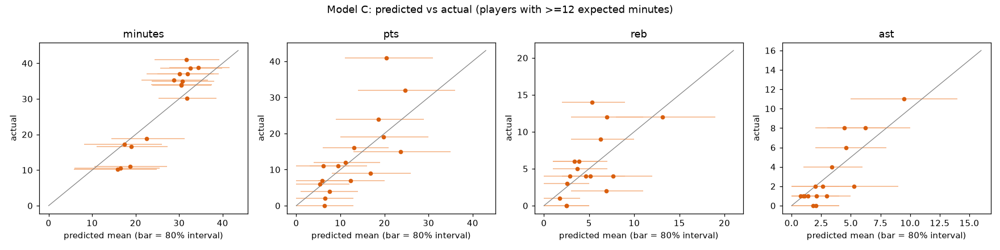
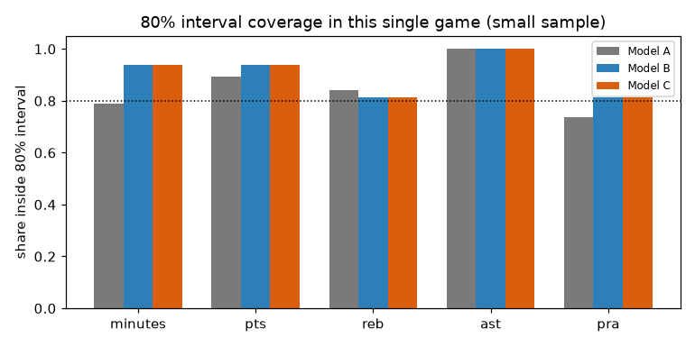
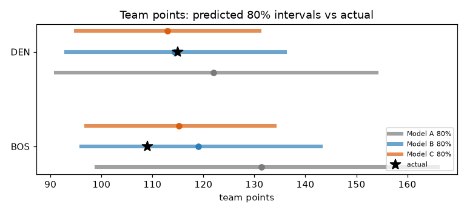

# Historical matchup demonstration: BOS at DEN, 2024-03-07

**Question.** What would the models have predicted before this game, and how did those predictions compare with what happened?

All numbers below are generated by `nba-sim demo-historical` from the frozen prediction files in `outputs/demo/22300906/`; nothing is typed by hand.

## 1. Game selection

Selected by a pregame-only rule (the outcome is never consulted): Pregame-only rule: in the last ~6 weeks of the final season, among games where every player on both active lists with >=15 expected minutes has >=100 prior NBA games, pick the game with the highest combined pregame win percentage of the two teams (ties: earliest date).

- 92 games satisfied the history requirement; the chosen game had the highest combined pregame win percentage (DEN 0.677, BOS 0.787) with 17 core players.

## 2. Information cutoff and protocol

- **Cutoff:** games dated before 2024-03-07 (cutoff = 00:00 local on game day). Training rows end on 2024-03-06 (114,537 player-games from seasons 2020-21, 2021-22, 2022-23, 2023-24).
- The target game's rows were rebuilt with every outcome field empty, from data cut strictly before the game date (`simulation/pregame.py`); the game id is asserted absent from training.
- **Pregame information used:** schedule (date, home/away, opponent) and the game's active list. The active list comes from the box score; the official inactive list is published before tip-off, but this dataset has no timestamp for it, so this is an *assumption* that it was known. Starting lineups, injury reports, and betting lines were NOT used.
- **Simulations:** exactly 10,000 joint draws per model, seed sequence [42, model index]. Predictions were written and SHA-256 hashed at 2026-10-29 09:21:24.486472+00:00 before the box score was loaded; hashes were re-verified before scoring:

| model | sha256 (predictions .npz) |
|---|---|
| A | `7a972abd333fa01e…` |
| B | `7de1beeea51caf84…` |
| C | `602544b8b862c90b…` |

Models: **A** — independent players and stats; per-game NB means; minutes drawn independently; **B** — A + simulated minutes (play/no-play, rotation features, team-minute constraint, OT); stats NB given minutes; **C** — B + pregame game conditions + shared dependence: team totals drawn jointly (within-team correlation, cross-team correlation, team shot-mix and shooting shocks) and allocated to players; blowout minutes.

## 3. Result

Final score: BOS 109, DEN 115.

### Team points

| model | team | predicted mean | 80% interval | actual | actual percentile | crps |
|---|---|---|---|---|---|---|
| A | BOS | 131.4 | 99–166 | 109 | 0.19 | 12.63 |
| A | DEN | 122.0 | 91–154 | 115 | 0.41 | 6.27 |
| B | BOS | 119.0 | 96–143 | 109 | 0.30 | 6.14 |
| B | DEN | 114.3 | 93–136 | 115 | 0.53 | 3.95 |
| C | BOS | 115.2 | 97–134 | 109 | 0.34 | 4.33 |
| C | DEN | 112.9 | 95–131 | 115 | 0.57 | 3.40 |

### Players (Model C; players with ≥12 expected minutes)

Intervals are central predictive intervals of the discrete distribution; *pct* is the actual outcome's mid-percentile F(y−1) + ½·p(y) within the frozen distribution.

**Points**

| player | mean | median | 50% | 80% | 95% | actual | pct |
|---|---|---|---|---|---|---|---|
| Jayson Tatum (BOS) | 23.7 | 23 | 18–29 | 13–35 | 7–42 | 15 | 0.16 |
| Jaylen Brown (BOS) | 20.4 | 20 | 15–26 | 11–31 | 6–38 | 41 | 0.99 |
| Jrue Holiday (BOS) | 11.2 | 11 | 7–15 | 4–19 | 2–23 | 12 | 0.59 |
| Derrick White (BOS) | 12.3 | 12 | 8–16 | 5–20 | 1–26 | 7 | 0.20 |
| Kristaps Porzingis (BOS) | 18.7 | 18 | 13–24 | 9–29 | 4–35 | 24 | 0.76 |
| Al Horford (BOS) | 6.5 | 6 | 3–9 | 0–13 | 0–17 | 2 | 0.16 |
| Payton Pritchard (BOS) | 6.4 | 6 | 3–9 | 0–13 | 0–18 | 0 | 0.08 |
| Sam Hauser (BOS) | 5.4 | 5 | 2–8 | 0–12 | 0–16 | 6 | 0.61 |
| Nikola Jokic (DEN) | 24.7 | 24 | 19–30 | 14–36 | 9–42 | 32 | 0.81 |
| Jamal Murray (DEN) | 19.8 | 19 | 15–25 | 10–30 | 5–36 | 19 | 0.48 |
| Michael Porter Jr. (DEN) | 16.8 | 16 | 12–21 | 8–26 | 4–32 | 9 | 0.13 |
| Kentavious Caldwell-Pope (DEN) | 9.5 | 9 | 6–13 | 3–16 | 0–21 | 11 | 0.64 |
| Aaron Gordon (DEN) | 13.1 | 13 | 9–17 | 6–21 | 2–26 | 16 | 0.71 |
| Christian Braun (DEN) | 5.9 | 5 | 3–8 | 0–12 | 0–15 | 7 | 0.64 |
| Reggie Jackson (DEN) | 7.5 | 7 | 4–11 | 1–14 | 0–19 | 4 | 0.26 |
| Peyton Watson (DEN) | 6.1 | 6 | 3–9 | 0–12 | 0–17 | 11 | 0.86 |

**Rebounds**

| player | mean | median | 50% | 80% | 95% | actual | pct |
|---|---|---|---|---|---|---|---|
| Jayson Tatum (BOS) | 7.6 | 7 | 5–10 | 4–12 | 2–14 | 4 | 0.12 |
| Jaylen Brown (BOS) | 5.3 | 5 | 3–7 | 2–9 | 1–11 | 14 | 1.00 |
| Jrue Holiday (BOS) | 4.6 | 4 | 3–6 | 2–8 | 0–10 | 4 | 0.43 |
| Derrick White (BOS) | 3.7 | 3 | 2–5 | 1–7 | 0–8 | 5 | 0.75 |
| Kristaps Porzingis (BOS) | 7.0 | 7 | 5–9 | 3–11 | 1–14 | 12 | 0.93 |
| Al Horford (BOS) | 5.2 | 5 | 3–7 | 2–9 | 0–11 | 4 | 0.37 |
| Payton Pritchard (BOS) | 2.5 | 2 | 1–4 | 0–5 | 0–7 | 0 | 0.09 |
| Sam Hauser (BOS) | 2.5 | 2 | 1–4 | 0–5 | 0–7 | 0 | 0.08 |
| Nikola Jokic (DEN) | 13.1 | 13 | 10–16 | 8–19 | 5–22 | 12 | 0.41 |
| Jamal Murray (DEN) | 3.9 | 4 | 2–5 | 1–7 | 0–9 | 6 | 0.83 |
| Michael Porter Jr. (DEN) | 6.9 | 7 | 5–9 | 3–11 | 2–13 | 2 | 0.04 |
| Kentavious Caldwell-Pope (DEN) | 2.5 | 2 | 1–4 | 0–5 | 0–6 | 3 | 0.64 |
| Aaron Gordon (DEN) | 6.3 | 6 | 4–8 | 3–10 | 1–12 | 9 | 0.83 |
| Christian Braun (DEN) | 3.4 | 3 | 2–5 | 1–6 | 0–8 | 6 | 0.87 |
| Reggie Jackson (DEN) | 1.8 | 2 | 1–3 | 0–4 | 0–5 | 1 | 0.36 |
| Peyton Watson (DEN) | 2.9 | 3 | 1–4 | 0–6 | 0–8 | 4 | 0.73 |

**Assists**

| player | mean | median | 50% | 80% | 95% | actual | pct |
|---|---|---|---|---|---|---|---|
| Jayson Tatum (BOS) | 4.5 | 4 | 3–6 | 2–8 | 0–10 | 8 | 0.92 |
| Jaylen Brown (BOS) | 3.4 | 3 | 2–5 | 1–6 | 0–8 | 4 | 0.65 |
| Jrue Holiday (BOS) | 5.2 | 5 | 3–7 | 2–9 | 1–11 | 2 | 0.10 |
| Derrick White (BOS) | 4.6 | 4 | 3–6 | 2–8 | 0–10 | 6 | 0.73 |
| Kristaps Porzingis (BOS) | 2.0 | 2 | 1–3 | 0–4 | 0–6 | 2 | 0.55 |
| Al Horford (BOS) | 2.1 | 2 | 1–3 | 0–4 | 0–6 | 0 | 0.09 |
| Payton Pritchard (BOS) | 1.8 | 1 | 1–3 | 0–4 | 0–6 | 0 | 0.12 |
| Sam Hauser (BOS) | 0.8 | 0 | 0–1 | 0–2 | 0–3 | 1 | 0.66 |
| Nikola Jokic (DEN) | 9.5 | 9 | 7–12 | 5–14 | 3–17 | 11 | 0.68 |
| Jamal Murray (DEN) | 6.2 | 6 | 4–8 | 3–10 | 1–12 | 8 | 0.74 |
| Michael Porter Jr. (DEN) | 1.4 | 1 | 0–2 | 0–3 | 0–4 | 1 | 0.43 |
| Kentavious Caldwell-Pope (DEN) | 2.1 | 2 | 1–3 | 0–4 | 0–6 | 1 | 0.26 |
| Aaron Gordon (DEN) | 2.9 | 3 | 2–4 | 1–5 | 0–7 | 1 | 0.16 |
| Christian Braun (DEN) | 1.1 | 1 | 0–2 | 0–3 | 0–4 | 1 | 0.53 |
| Reggie Jackson (DEN) | 2.6 | 2 | 1–4 | 0–5 | 0–7 | 2 | 0.43 |
| Peyton Watson (DEN) | 1.0 | 1 | 0–2 | 0–2 | 0–4 | 1 | 0.57 |

**Points+Rebounds+Assists**

| player | mean | median | 50% | 80% | 95% | actual | pct |
|---|---|---|---|---|---|---|---|
| Jayson Tatum (BOS) | 35.8 | 36 | 29–43 | 22–50 | 15–58 | 27 | 0.20 |
| Jaylen Brown (BOS) | 29.2 | 29 | 23–35 | 17–42 | 11–50 | 59 | 1.00 |
| Jrue Holiday (BOS) | 21.0 | 21 | 16–26 | 12–31 | 7–37 | 18 | 0.36 |
| Derrick White (BOS) | 20.6 | 20 | 15–26 | 11–31 | 6–37 | 18 | 0.39 |
| Kristaps Porzingis (BOS) | 27.6 | 27 | 21–34 | 16–40 | 8–48 | 38 | 0.86 |
| Al Horford (BOS) | 13.7 | 13 | 9–18 | 6–23 | 0–28 | 6 | 0.11 |
| Payton Pritchard (BOS) | 10.6 | 10 | 6–15 | 2–20 | 0–26 | 0 | 0.04 |
| Sam Hauser (BOS) | 8.6 | 8 | 4–12 | 1–16 | 0–22 | 7 | 0.43 |
| Nikola Jokic (DEN) | 47.3 | 47 | 39–55 | 32–63 | 24–73 | 55 | 0.74 |
| Jamal Murray (DEN) | 29.9 | 29 | 24–36 | 18–43 | 11–50 | 33 | 0.64 |
| Michael Porter Jr. (DEN) | 25.1 | 25 | 19–31 | 15–36 | 9–43 | 12 | 0.06 |
| Kentavious Caldwell-Pope (DEN) | 14.1 | 14 | 10–18 | 7–22 | 3–27 | 15 | 0.59 |
| Aaron Gordon (DEN) | 22.3 | 22 | 17–27 | 13–32 | 8–39 | 26 | 0.70 |
| Christian Braun (DEN) | 10.3 | 10 | 6–14 | 3–18 | 0–23 | 14 | 0.75 |
| Reggie Jackson (DEN) | 11.9 | 11 | 7–16 | 4–21 | 0–26 | 7 | 0.23 |
| Peyton Watson (DEN) | 10.0 | 10 | 6–14 | 3–18 | 0–23 | 16 | 0.85 |

**Minutes**

| player | mean | median | 50% | 80% | 95% | actual | pct |
|---|---|---|---|---|---|---|---|
| Jayson Tatum (BOS) | 32.5 | 32.8 | 29–36 | 26–40 | 19–44 | 38.6 | 0.86 |
| Jaylen Brown (BOS) | 31.7 | 32.1 | 28–36 | 24–39 | 17–44 | 41.1 | 0.94 |
| Jrue Holiday (BOS) | 30.8 | 31.2 | 28–35 | 24–38 | 17–43 | 34.9 | 0.76 |
| Derrick White (BOS) | 30.1 | 30.3 | 26–34 | 22–38 | 16–43 | 37.0 | 0.87 |
| Kristaps Porzingis (BOS) | 28.8 | 29.2 | 25–33 | 21–37 | 14–41 | 35.3 | 0.86 |
| Al Horford (BOS) | 22.6 | 22.7 | 19–27 | 14–31 | 3–36 | 18.9 | 0.26 |
| Payton Pritchard (BOS) | 16.5 | 16.8 | 12–21 | 6–26 | 0–31 | 10.6 | 0.18 |
| Sam Hauser (BOS) | 15.9 | 16.2 | 12–21 | 6–25 | 0–30 | 10.3 | 0.19 |
| Nikola Jokic (DEN) | 34.5 | 34.8 | 31–38 | 28–42 | 22–46 | 38.8 | 0.78 |
| Jamal Murray (DEN) | 31.9 | 32.3 | 29–36 | 25–39 | 19–43 | 37.0 | 0.82 |
| Michael Porter Jr. (DEN) | 31.8 | 32.2 | 29–35 | 25–39 | 19–43 | 30.1 | 0.33 |
| Kentavious Caldwell-Pope (DEN) | 30.5 | 30.9 | 27–34 | 24–37 | 17–42 | 33.9 | 0.72 |
| Aaron Gordon (DEN) | 30.5 | 30.9 | 27–34 | 24–38 | 17–41 | 34.0 | 0.73 |
| Christian Braun (DEN) | 19.0 | 19.2 | 15–23 | 11–27 | 0–32 | 16.7 | 0.32 |
| Reggie Jackson (DEN) | 18.8 | 19.1 | 15–23 | 11–27 | 0–32 | 11.1 | 0.11 |
| Peyton Watson (DEN) | 17.5 | 17.7 | 14–22 | 8–26 | 0–31 | 17.3 | 0.47 |

### Predeclared threshold probabilities (Model C)

Thresholds are fixed in `configs/default.yaml` (`evaluation.thresholds`) before any run. ✔ = event happened.

| player | pts≥15 | pts≥20 | pts≥25 | reb≥5 | reb≥8 | ast≥5 | pra≥30 |
|---|---|---|---|---|---|---|---|
| Jayson Tatum (BOS) | 0.86 ✔ | 0.67 | 0.45 | 0.84 | 0.49 | 0.46 ✔ | 0.72 |
| Jaylen Brown (BOS) | 0.77 ✔ | 0.53 ✔ | 0.29 ✔ | 0.59 ✔ | 0.20 ✔ | 0.27 | 0.47 ✔ |
| Jrue Holiday (BOS) | 0.26 | 0.08 | 0.02 | 0.48 | 0.11 | 0.58 | 0.13 |
| Derrick White (BOS) | 0.34 | 0.12 | 0.03 | 0.32 ✔ | 0.05 | 0.48 ✔ | 0.13 |
| Kristaps Porzingis (BOS) | 0.69 ✔ | 0.44 ✔ | 0.22 | 0.78 ✔ | 0.41 ✔ | 0.07 | 0.41 ✔ |
| Al Horford (BOS) | 0.06 | 0.01 | 0.00 | 0.56 | 0.20 | 0.09 | 0.02 |
| Payton Pritchard (BOS) | 0.07 | 0.02 | 0.00 | 0.15 | 0.02 | 0.07 | 0.01 |
| Sam Hauser (BOS) | 0.04 | 0.01 | 0.00 | 0.15 | 0.02 | 0.00 | 0.00 |
| Nikola Jokic (DEN) | 0.90 ✔ | 0.73 ✔ | 0.50 ✔ | 0.98 ✔ | 0.91 ✔ | 0.92 ✔ | 0.93 ✔ |
| Jamal Murray (DEN) | 0.75 ✔ | 0.49 | 0.26 | 0.36 ✔ | 0.06 | 0.70 ✔ | 0.50 ✔ |
| Michael Porter Jr. (DEN) | 0.61 | 0.34 | 0.14 | 0.78 | 0.40 | 0.02 | 0.29 |
| Kentavious Caldwell-Pope (DEN) | 0.16 | 0.04 | 0.01 | 0.13 | 0.01 | 0.07 | 0.01 |
| Aaron Gordon (DEN) | 0.38 ✔ | 0.14 | 0.04 | 0.72 ✔ | 0.31 ✔ | 0.19 | 0.17 |
| Christian Braun (DEN) | 0.03 | 0.00 | 0.00 | 0.28 ✔ | 0.05 | 0.01 | 0.00 |
| Reggie Jackson (DEN) | 0.09 | 0.02 | 0.00 | 0.05 | 0.00 | 0.17 | 0.01 |
| Peyton Watson (DEN) | 0.05 | 0.01 | 0.00 | 0.20 | 0.03 | 0.01 | 0.00 |

## 4. Model A vs B vs C in this game

| model | CRPS minutes | in 80% minutes | CRPS pts | in 80% pts | CRPS reb | in 80% reb | CRPS ast | in 80% ast | CRPS pra | in 80% pra |
|---|---|---|---|---|---|---|---|---|---|---|
| A | 3.95 | 81% | 3.84 | 88% | 1.88 | 81% | 0.92 | 100% | 5.73 | 75% |
| B | 2.98 | 94% | 3.52 | 94% | 1.80 | 81% | 0.86 | 100% | 5.10 | 81% |
| C | 3.07 | 94% | 3.56 | 94% | 1.80 | 81% | 0.86 | 100% | 5.14 | 81% |

Mean CRPS over the 16 core players (lower is better). One game is a sample of ~16 correlated player outcomes: these numbers illustrate the forecasts and are **not** evidence about which model is better. That question is answered by the backtest (`reports/validation_report.md`).

## 5. Calibration context from the full backtest

Empirical coverage of central intervals over all backtest player-games (run `main`). For integer stats the nominal 80% interval carries more than 80% predictive mass (`mass80`); calibration means `cov80` ≈ `mass80`.

| model | stat | n | cov50 | cov80 | mass80 | cov95 | crps |
|---|---|---|---|---|---|---|---|
| A | ast | 93848 | 0.759 | 0.917 | 0.922 | 0.974 | 0.807 |
| A | minutes | 93848 | 0.555 | 0.834 | 0.800 | 0.962 | 4.168 |
| A | pra | 93848 | 0.461 | 0.716 | 0.846 | 0.876 | 4.298 |
| A | pts | 93848 | 0.606 | 0.858 | 0.866 | 0.961 | 3.045 |
| A | reb | 93848 | 0.689 | 0.898 | 0.894 | 0.970 | 1.287 |
| B | ast | 93848 | 0.765 | 0.922 | 0.918 | 0.983 | 0.762 |
| B | minutes | 93848 | 0.562 | 0.844 | 0.800 | 0.969 | 3.524 |
| B | pra | 93848 | 0.596 | 0.851 | 0.855 | 0.968 | 3.794 |
| B | pts | 93848 | 0.638 | 0.871 | 0.869 | 0.973 | 2.786 |
| B | reb | 93848 | 0.692 | 0.896 | 0.893 | 0.977 | 1.170 |
| C | ast | 93848 | 0.765 | 0.921 | 0.918 | 0.983 | 0.755 |
| C | minutes | 93848 | 0.559 | 0.845 | 0.800 | 0.970 | 3.525 |
| C | pra | 93848 | 0.595 | 0.850 | 0.855 | 0.968 | 3.782 |
| C | pts | 93848 | 0.630 | 0.866 | 0.869 | 0.971 | 2.781 |
| C | reb | 93848 | 0.690 | 0.894 | 0.893 | 0.977 | 1.166 |

## 6. Figures

## 7. Findings

- pts: 15 of 16 core players finished inside Model C's 80% interval.
- reb: 13 of 16 core players finished inside Model C's 80% interval.
- ast: 16 of 16 core players finished inside Model C's 80% interval.
- minutes: 15 of 16 core players finished inside Model C's 80% interval.
- Points outcomes in the outer 5% tails of Model C: Jaylen Brown 41 pts (pct 0.99, predicted mean 20.4).

## 8. Limitations

- Single game: illustrative only; see the backtest for evidence.
- The active list is assumed known pregame (see §2). Real-time injury news, minutes restrictions and lineup announcements are not modelled; a late scratch of a starter would not be reflected.
- The demo models are fit with the information cutoff at the game date; the backtest refits every 14 days, so the backtest's own forecast for this game used a slightly older fit.
- No betting market information is used, and nothing here measures profitability.
