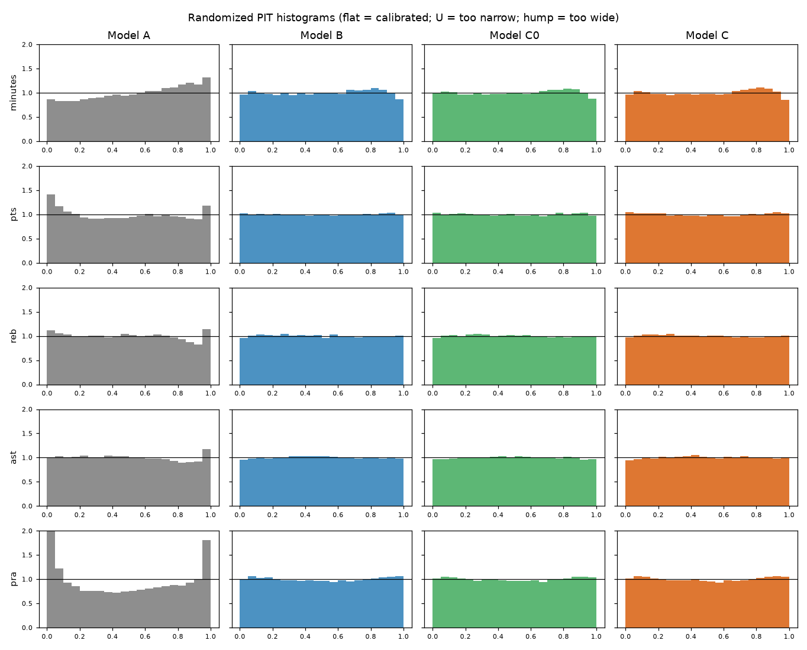
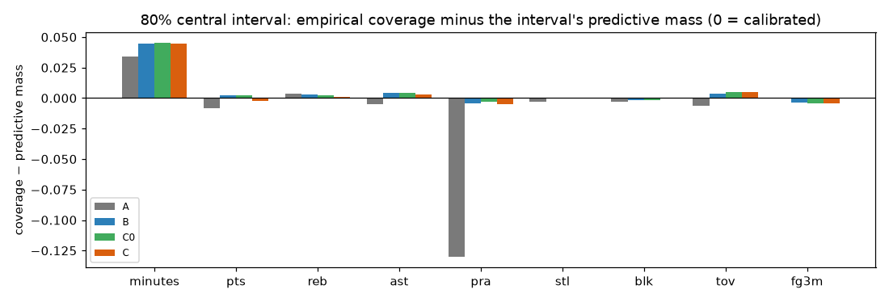
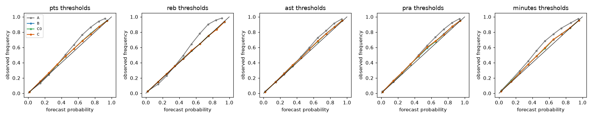
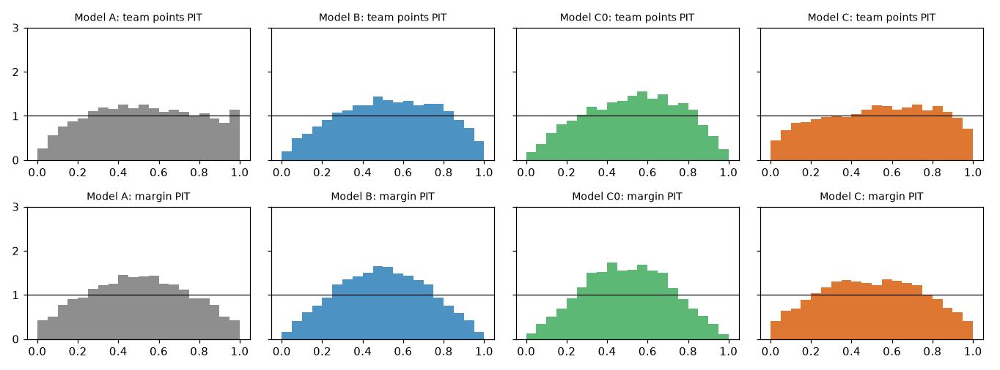
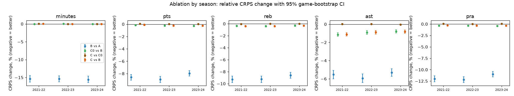
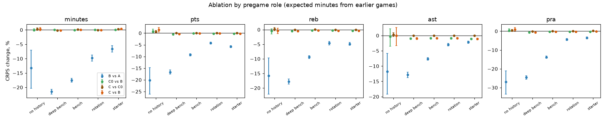
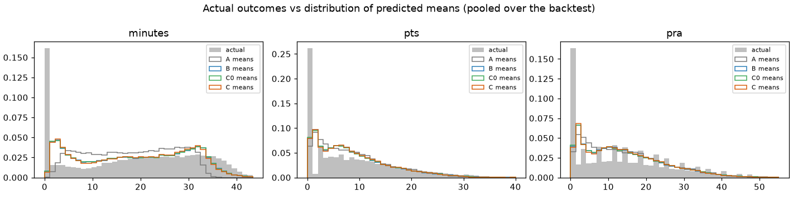

# Validation report: NBA player outcome distributions

Generated by `nba-sim report` from the saved backtest scores (`outputs/backtest/main/scores/`). All numbers are computed, not typed.

## 1. Evaluation design

- **Data:** github.com/NocturneBear/NBA-Data-2010-2024 (MIT); underlying data NBA.com boxscoretraditionalv3; dataset id `eedb6060747f242f`; raw files SHA-256 in `outputs/backtest/main/manifest.json`. Regular season only.
- **Evaluation period:** seasons 2021-22, 2022-23, 2023-24; 39 rolling origins (2021-10-19 … 2024-04-09), refit every 14 days; training at each origin = all rows dated before the origin within the current and previous 3 seasons, recency-weighted (half-life 365 days) with intercepts re-estimated on the last 30 days.
- **Sample:** 3,690 games, 93,848 active player-games per model (played or DNP). Players on the inactive list (DND/NWT) are excluded by design — the forecast universe is the active list, assumed known pregame (published before tip-off; no timestamp in the data).
- **Simulation:** 2,000 joint draws per player-game and model; seed 20251029 with per-(window, model, chunk) seed sequences recorded in each prediction file.
- **Freeze protocol:** each window's predictions are written to `predictions/<model>/wNNN.npz` (full discrete predictive PMFs, minutes quantiles, team and joint draws) before any outcome is read; `evaluate` joins outcomes afterwards.

### Models

- **A**: independent players and stats; per-game NB means; minutes drawn independently
- **B**: A + simulated minutes (play/no-play, rotation features, team-minute constraint, OT); stats NB given minutes
- **C0**: B + pregame game conditions (pace, opponent, vacated usage, home) in the means only; players independent given minutes (ablation)
- **C**: B + pregame game conditions + shared dependence: team totals drawn jointly (within-team correlation, cross-team correlation, team shot-mix and shooting shocks) and allocated to players; blowout minutes

## 2. Metrics and what they are used for

| metric | used for | why |
|---|---|---|
| CRPS (exact for counts, quantile-grid for minutes) | every stat, team totals, margins | proper, in the units of the stat, defined for discrete and continuous outcomes and for derived stats (PRA) |
| log score (negative log-likelihood) | primitive counts (FGA, FTA, REB, AST, STL, BLK, TOV) | strictly proper and sensitive to tails; computed from Rao-Blackwellized PMFs so no zero-probability artefacts. Not used for derived stats (PTS, PRA) whose PMFs are only available as Monte Carlo histograms, nor for minutes (point mass at 0 + continuous part) |
| MAE of the median / RMSE of the mean | point-forecast accuracy | familiar, but not distributional |
| randomized PIT | calibration of every stat | uniform under calibration even for counts |
| interval coverage vs predictive mass | 50/80/95% central intervals | for integer stats a central interval carries more than its nominal mass; calibration means coverage ≈ that mass |
| Brier score + reliability | predeclared threshold events P(stat ≥ t) | proper for binary events |
| variogram score (order ½) | joint distribution of teammates' PTS/REB/AST | proper multivariate score that is sensitive to dependence structure (the energy score is not) |
| team-total dispersion ratio | E[(total − mean)²] / predicted variance | > 1 too narrow, < 1 too wide; isolates dependence errors |

Scores are only compared across models on identical observations (same games, same players, same stat).

## 3. Overall results

Mean score per player-game (lower is better). `cov80`/`mass80`: empirical coverage of the central 80% interval and its average predictive mass; `pit80`: share of randomized PITs in [0.1, 0.9] (0.80 if calibrated). `bias`: mean prediction minus mean outcome.

| stat | model | n | CRPS | logS | MAE | RMSE | bias | cov80 | mass80 | pit80 | cov95 | mass95 |
|---|---|---|---|---|---|---|---|---|---|---|---|---|
| minutes | A | 93,848 | 4.168 | – | 5.900 | 7.867 | -0.753 | 0.834 | 0.800 | 0.790 | 0.962 | 0.950 |
| minutes | B | 93,848 | 3.524 | – | 4.886 | 6.758 | +0.003 | 0.844 | 0.800 | 0.806 | 0.969 | 0.950 |
| minutes | C | 93,848 | 3.525 | – | 4.893 | 6.758 | +0.003 | 0.845 | 0.800 | 0.806 | 0.970 | 0.950 |
| minutes | C0 | 93,848 | 3.525 | – | 4.887 | 6.758 | +0.003 | 0.845 | 0.800 | 0.806 | 0.969 | 0.950 |
| pts | A | 93,848 | 3.045 | – | 4.271 | 5.820 | -0.097 | 0.858 | 0.866 | 0.766 | 0.961 | 0.973 |
| pts | B | 93,848 | 2.786 | – | 3.917 | 5.559 | -0.097 | 0.871 | 0.869 | 0.797 | 0.973 | 0.973 |
| pts | C | 93,848 | 2.781 | – | 3.911 | 5.554 | -0.105 | 0.866 | 0.869 | 0.793 | 0.971 | 0.973 |
| pts | C0 | 93,848 | 2.780 | – | 3.908 | 5.549 | -0.080 | 0.871 | 0.869 | 0.798 | 0.973 | 0.973 |
| reb | A | 93,848 | 1.287 | 2.084 | 1.794 | 2.494 | -0.024 | 0.898 | 0.894 | 0.794 | 0.970 | 0.980 |
| reb | B | 93,848 | 1.170 | 1.916 | 1.641 | 2.370 | +0.000 | 0.896 | 0.893 | 0.802 | 0.977 | 0.979 |
| reb | C | 93,848 | 1.166 | 1.913 | 1.635 | 2.360 | +0.002 | 0.894 | 0.893 | 0.801 | 0.977 | 0.979 |
| reb | C0 | 93,848 | 1.166 | 1.913 | 1.636 | 2.361 | +0.001 | 0.896 | 0.893 | 0.802 | 0.978 | 0.979 |
| ast | A | 93,848 | 0.807 | 1.574 | 1.128 | 1.707 | -0.027 | 0.917 | 0.922 | 0.793 | 0.974 | 0.984 |
| ast | B | 93,848 | 0.762 | 1.490 | 1.067 | 1.652 | -0.023 | 0.922 | 0.918 | 0.804 | 0.983 | 0.983 |
| ast | C | 93,848 | 0.755 | 1.483 | 1.059 | 1.634 | -0.025 | 0.921 | 0.918 | 0.806 | 0.983 | 0.983 |
| ast | C0 | 93,848 | 0.755 | 1.483 | 1.059 | 1.634 | -0.019 | 0.922 | 0.918 | 0.806 | 0.983 | 0.983 |
| stl | A | 93,848 | 0.365 | 0.950 | 0.516 | 0.823 | -0.004 | 0.946 | 0.949 | 0.803 | 0.985 | 0.988 |
| stl | B | 93,848 | 0.355 | 0.923 | 0.510 | 0.811 | -0.000 | 0.947 | 0.947 | 0.800 | 0.987 | 0.988 |
| stl | C | 93,848 | 0.355 | 0.922 | 0.508 | 0.811 | +0.000 | 0.948 | 0.947 | 0.803 | 0.987 | 0.988 |
| stl | C0 | 93,848 | 0.355 | 0.922 | 0.508 | 0.811 | -0.000 | 0.947 | 0.948 | 0.801 | 0.987 | 0.988 |
| blk | A | 93,848 | 0.257 | 0.712 | 0.347 | 0.671 | -0.002 | 0.952 | 0.955 | 0.800 | 0.986 | 0.989 |
| blk | B | 93,848 | 0.253 | 0.694 | 0.345 | 0.666 | +0.001 | 0.953 | 0.954 | 0.800 | 0.988 | 0.989 |
| blk | C | 93,848 | 0.251 | 0.692 | 0.344 | 0.662 | +0.003 | 0.954 | 0.954 | 0.800 | 0.988 | 0.989 |
| blk | C0 | 93,848 | 0.251 | 0.692 | 0.344 | 0.662 | +0.001 | 0.953 | 0.954 | 0.799 | 0.988 | 0.989 |
| tov | A | 93,848 | 0.507 | 1.205 | 0.717 | 1.081 | -0.006 | 0.935 | 0.942 | 0.795 | 0.982 | 0.987 |
| tov | B | 93,848 | 0.488 | 1.162 | 0.692 | 1.056 | -0.002 | 0.942 | 0.938 | 0.807 | 0.988 | 0.986 |
| tov | C | 93,848 | 0.486 | 1.159 | 0.690 | 1.052 | -0.001 | 0.943 | 0.938 | 0.809 | 0.988 | 0.986 |
| tov | C0 | 93,848 | 0.486 | 1.158 | 0.690 | 1.052 | -0.001 | 0.942 | 0.938 | 0.807 | 0.988 | 0.986 |
| fgm | A | 93,848 | 1.162 | – | 1.627 | 2.233 | -0.037 | 0.910 | 0.899 | 0.802 | 0.974 | 0.980 |
| fgm | B | 93,848 | 1.064 | – | 1.498 | 2.137 | -0.036 | 0.898 | 0.897 | 0.798 | 0.979 | 0.979 |
| fgm | C | 93,848 | 1.063 | – | 1.495 | 2.136 | -0.040 | 0.895 | 0.897 | 0.796 | 0.978 | 0.979 |
| fgm | C0 | 93,848 | 1.062 | – | 1.495 | 2.135 | -0.030 | 0.898 | 0.896 | 0.800 | 0.979 | 0.979 |
| fga | A | 93,848 | 2.047 | 2.614 | 2.789 | 3.698 | -0.063 | 0.867 | 0.868 | 0.780 | 0.958 | 0.973 |
| fga | B | 93,848 | 1.744 | 2.307 | 2.439 | 3.418 | -0.049 | 0.892 | 0.872 | 0.821 | 0.979 | 0.973 |
| fga | C | 93,848 | 1.734 | 2.300 | 2.424 | 3.403 | -0.044 | 0.890 | 0.872 | 0.820 | 0.978 | 0.973 |
| fga | C0 | 93,848 | 1.735 | 2.301 | 2.423 | 3.402 | -0.034 | 0.893 | 0.872 | 0.823 | 0.979 | 0.973 |
| fg3m | A | 93,848 | 0.496 | – | 0.693 | 1.135 | -0.010 | 0.941 | 0.941 | 0.806 | 0.983 | 0.987 |
| fg3m | B | 93,848 | 0.480 | – | 0.672 | 1.113 | -0.010 | 0.934 | 0.938 | 0.797 | 0.983 | 0.987 |
| fg3m | C | 93,848 | 0.480 | – | 0.673 | 1.114 | -0.009 | 0.934 | 0.938 | 0.797 | 0.983 | 0.987 |
| fg3m | C0 | 93,848 | 0.480 | – | 0.673 | 1.114 | -0.008 | 0.934 | 0.938 | 0.797 | 0.983 | 0.987 |
| fg3a | A | 93,848 | 0.974 | – | 1.346 | 1.979 | -0.018 | 0.922 | 0.909 | 0.816 | 0.978 | 0.982 |
| fg3a | B | 93,848 | 0.890 | – | 1.242 | 1.882 | -0.016 | 0.917 | 0.906 | 0.818 | 0.982 | 0.981 |
| fg3a | C | 93,848 | 0.891 | – | 1.245 | 1.885 | -0.013 | 0.918 | 0.906 | 0.818 | 0.983 | 0.981 |
| fg3a | C0 | 93,848 | 0.892 | – | 1.246 | 1.886 | -0.009 | 0.917 | 0.906 | 0.816 | 0.983 | 0.981 |
| ftm | A | 93,848 | 0.753 | – | 1.050 | 1.698 | -0.012 | 0.932 | 0.932 | 0.807 | 0.980 | 0.983 |
| ftm | B | 93,848 | 0.725 | – | 1.014 | 1.676 | -0.015 | 0.930 | 0.928 | 0.797 | 0.984 | 0.982 |
| ftm | C | 93,848 | 0.718 | – | 1.009 | 1.673 | -0.016 | 0.925 | 0.926 | 0.791 | 0.984 | 0.982 |
| ftm | C0 | 93,848 | 0.721 | – | 1.010 | 1.669 | -0.011 | 0.929 | 0.928 | 0.796 | 0.984 | 0.982 |
| fta | A | 93,848 | 0.938 | 1.556 | 1.325 | 2.025 | -0.014 | 0.926 | 0.927 | 0.799 | 0.978 | 0.982 |
| fta | B | 93,848 | 0.897 | 1.487 | 1.266 | 1.995 | -0.017 | 0.924 | 0.922 | 0.790 | 0.984 | 0.981 |
| fta | C | 93,848 | 0.887 | 1.481 | 1.257 | 1.991 | -0.015 | 0.918 | 0.920 | 0.781 | 0.984 | 0.981 |
| fta | C0 | 93,848 | 0.893 | 1.484 | 1.260 | 1.986 | -0.011 | 0.924 | 0.922 | 0.791 | 0.984 | 0.981 |
| pra | A | 93,848 | 4.298 | – | 5.924 | 7.845 | -0.148 | 0.716 | 0.846 | 0.649 | 0.876 | 0.966 |
| pra | B | 93,848 | 3.794 | – | 5.323 | 7.360 | -0.119 | 0.851 | 0.855 | 0.791 | 0.968 | 0.970 |
| pra | C | 93,848 | 3.782 | – | 5.311 | 7.347 | -0.129 | 0.850 | 0.855 | 0.791 | 0.968 | 0.970 |
| pra | C0 | 93,848 | 3.780 | – | 5.304 | 7.341 | -0.097 | 0.852 | 0.855 | 0.792 | 0.969 | 0.970 |

Minutes have a point mass at 0 (DNP). When P(0) exceeds the interval's lower tail, the central interval starts at 0 and every DNP is 'covered', so minutes `cov80` overstates coverage; the randomized PIT (`pit80`) handles the point mass and is the calibration measure to read for minutes.

Log-score floor (p < 1e-12 or outcome beyond support) hit on at most 0.00852% of observations for any stat/model.

## 4. Model comparisons (95% game-level cluster bootstrap)

Difference in mean score, first model minus second (negative = first model better), with a 2,000-replicate bootstrap over games (all players of a game are resampled together). *improves/worsens* = CI excludes 0; *tie* = it does not.

| stat | metric | B − A | C0 − B | C − C0 | C − B | C − A |
|---|---|---|---|---|---|---|
| minutes | CRPS | -0.644 [-0.665, -0.623] (-15.4%) improves | +0.000 [-0.001, +0.001] (+0.0%) tie | +0.001 [-0.001, +0.002] (+0.0%) tie | +0.001 [-0.001, +0.003] (+0.0%) tie | -0.643 [-0.664, -0.622] (-15.4%) improves |
| pts | CRPS | -0.259 [-0.267, -0.251] (-8.5%) improves | -0.006 [-0.008, -0.004] (-0.2%) improves | +0.001 [-0.000, +0.002] (+0.0%) tie | -0.005 [-0.007, -0.004] (-0.2%) improves | -0.264 [-0.273, -0.256] (-8.7%) improves |
| reb | CRPS | -0.117 [-0.120, -0.113] (-9.1%) improves | -0.004 [-0.005, -0.003] (-0.3%) improves | -0.000 [-0.001, +0.000] (-0.0%) tie | -0.004 [-0.005, -0.003] (-0.4%) improves | -0.121 [-0.125, -0.117] (-9.4%) improves |
| reb | log score | -0.168 [-0.174, -0.163] (-8.1%) improves | -0.002 [-0.003, -0.002] (-0.1%) improves | -0.000 [-0.000, +0.000] (-0.0%) tie | -0.003 [-0.003, -0.002] (-0.1%) improves | -0.171 [-0.176, -0.166] (-8.2%) improves |
| ast | CRPS | -0.045 [-0.047, -0.043] (-5.6%) improves | -0.007 [-0.008, -0.006] (-0.9%) improves | +0.000 [-0.000, +0.000] (+0.0%) tie | -0.007 [-0.008, -0.006] (-0.9%) improves | -0.052 [-0.055, -0.050] (-6.5%) improves |
| ast | log score | -0.084 [-0.088, -0.080] (-5.3%) improves | -0.006 [-0.007, -0.006] (-0.4%) improves | -0.000 [-0.000, +0.000] (-0.0%) tie | -0.006 [-0.007, -0.006] (-0.4%) improves | -0.090 [-0.094, -0.087] (-5.7%) improves |
| stl | CRPS | -0.009 [-0.010, -0.009] (-2.5%) improves | -0.001 [-0.001, -0.000] (-0.2%) improves | +0.000 [-0.000, +0.000] (+0.0%) tie | -0.001 [-0.001, -0.000] (-0.1%) improves | -0.010 [-0.010, -0.009] (-2.7%) improves |
| stl | log score | -0.027 [-0.028, -0.025] (-2.8%) improves | -0.001 [-0.001, -0.001] (-0.1%) improves | -0.000 [-0.000, +0.000] (-0.0%) tie | -0.001 [-0.001, -0.001] (-0.1%) improves | -0.028 [-0.029, -0.026] (-2.9%) improves |
| blk | CRPS | -0.004 [-0.005, -0.004] (-1.7%) improves | -0.001 [-0.002, -0.001] (-0.5%) improves | -0.000 [-0.000, +0.000] (-0.0%) tie | -0.001 [-0.002, -0.001] (-0.5%) improves | -0.006 [-0.006, -0.005] (-2.2%) improves |
| blk | log score | -0.018 [-0.019, -0.017] (-2.5%) improves | -0.002 [-0.002, -0.002] (-0.3%) improves | +0.000 [-0.000, +0.000] (+0.0%) tie | -0.002 [-0.002, -0.002] (-0.3%) improves | -0.020 [-0.021, -0.019] (-2.8%) improves |
| tov | CRPS | -0.019 [-0.020, -0.018] (-3.7%) improves | -0.002 [-0.003, -0.002] (-0.5%) improves | +0.000 [+0.000, +0.000] (+0.1%) worsens | -0.002 [-0.003, -0.002] (-0.5%) improves | -0.021 [-0.022, -0.020] (-4.1%) improves |
| tov | log score | -0.043 [-0.046, -0.041] (-3.6%) improves | -0.004 [-0.004, -0.003] (-0.3%) improves | +0.000 [+0.000, +0.000] (+0.0%) worsens | -0.003 [-0.004, -0.003] (-0.3%) improves | -0.047 [-0.050, -0.044] (-3.9%) improves |
| fgm | CRPS | -0.098 [-0.101, -0.095] (-8.4%) improves | -0.002 [-0.003, -0.001] (-0.2%) improves | +0.000 [+0.000, +0.001] (+0.0%) worsens | -0.001 [-0.002, -0.001] (-0.1%) improves | -0.099 [-0.103, -0.096] (-8.6%) improves |
| fga | CRPS | -0.302 [-0.310, -0.295] (-14.8%) improves | -0.010 [-0.011, -0.008] (-0.6%) improves | -0.001 [-0.001, +0.000] (-0.0%) tie | -0.010 [-0.012, -0.009] (-0.6%) improves | -0.313 [-0.320, -0.305] (-15.3%) improves |
| fga | log score | -0.308 [-0.315, -0.300] (-11.8%) improves | -0.006 [-0.006, -0.005] (-0.2%) improves | -0.001 [-0.002, -0.001] (-0.1%) improves | -0.007 [-0.008, -0.006] (-0.3%) improves | -0.315 [-0.322, -0.307] (-12.0%) improves |
| fg3m | CRPS | -0.016 [-0.017, -0.015] (-3.2%) improves | +0.000 [+0.000, +0.001] (+0.1%) worsens | +0.000 [-0.000, +0.000] (+0.0%) tie | +0.001 [+0.000, +0.001] (+0.1%) worsens | -0.016 [-0.017, -0.014] (-3.1%) improves |
| fg3a | CRPS | -0.084 [-0.087, -0.081] (-8.6%) improves | +0.001 [+0.000, +0.002] (+0.1%) worsens | -0.000 [-0.001, -0.000] (-0.0%) improves | +0.001 [+0.000, +0.001] (+0.1%) worsens | -0.083 [-0.086, -0.080] (-8.5%) improves |
| ftm | CRPS | -0.028 [-0.030, -0.027] (-3.8%) improves | -0.003 [-0.004, -0.003] (-0.4%) improves | -0.003 [-0.004, -0.003] (-0.5%) improves | -0.007 [-0.007, -0.006] (-0.9%) improves | -0.035 [-0.037, -0.034] (-4.7%) improves |
| fta | CRPS | -0.041 [-0.043, -0.039] (-4.4%) improves | -0.004 [-0.005, -0.004] (-0.5%) improves | -0.005 [-0.006, -0.005] (-0.6%) improves | -0.010 [-0.011, -0.009] (-1.1%) improves | -0.051 [-0.053, -0.049] (-5.4%) improves |
| fta | log score | -0.069 [-0.072, -0.066] (-4.4%) improves | -0.003 [-0.003, -0.003] (-0.2%) improves | -0.003 [-0.004, -0.002] (-0.2%) improves | -0.006 [-0.007, -0.005] (-0.4%) improves | -0.075 [-0.078, -0.072] (-4.8%) improves |
| pra | CRPS | -0.504 [-0.520, -0.490] (-11.7%) improves | -0.014 [-0.017, -0.011] (-0.4%) improves | +0.002 [+0.000, +0.003] (+0.0%) worsens | -0.012 [-0.015, -0.010] (-0.3%) improves | -0.517 [-0.532, -0.502] (-12.0%) improves |

## 5. Calibration

### Predeclared threshold events

Brier scores (lower is better):

| stat | threshold | base rate | A | B | C0 | C |
|---|---|---|---|---|---|---|
| ast | 3 | 0.302 | 0.1257 | 0.1186 | 0.1176 | 0.1177 |
| ast | 5 | 0.147 | 0.0766 | 0.0732 | 0.0722 | 0.0722 |
| ast | 8 | 0.046 | 0.0315 | 0.0309 | 0.0304 | 0.0304 |
| fg3m | 2 | 0.263 | 0.1383 | 0.1338 | 0.1339 | 0.1339 |
| fg3m | 3 | 0.138 | 0.0936 | 0.0918 | 0.0919 | 0.0919 |
| minutes | 20 | 0.509 | 0.1178 | 0.0981 | 0.0981 | 0.0981 |
| minutes | 30 | 0.255 | 0.1154 | 0.1006 | 0.1006 | 0.1012 |
| pra | 20 | 0.312 | 0.1195 | 0.1102 | 0.1097 | 0.1097 |
| pra | 30 | 0.138 | 0.0700 | 0.0671 | 0.0668 | 0.0670 |
| pra | 40 | 0.047 | 0.0310 | 0.0303 | 0.0302 | 0.0302 |
| pts | 10 | 0.392 | 0.1405 | 0.1293 | 0.1289 | 0.1288 |
| pts | 15 | 0.238 | 0.1088 | 0.1019 | 0.1015 | 0.1016 |
| pts | 20 | 0.134 | 0.0738 | 0.0699 | 0.0697 | 0.0698 |
| pts | 25 | 0.069 | 0.0450 | 0.0432 | 0.0430 | 0.0431 |
| pts | 30 | 0.033 | 0.0251 | 0.0243 | 0.0243 | 0.0243 |
| reb | 5 | 0.310 | 0.1467 | 0.1353 | 0.1348 | 0.1347 |
| reb | 8 | 0.126 | 0.0775 | 0.0721 | 0.0717 | 0.0717 |
| reb | 10 | 0.067 | 0.0455 | 0.0430 | 0.0428 | 0.0428 |

Brier differences pooled over each stat's thresholds:

| stat | comparison | Brier diff [95% CI] | verdict |
|---|---|---|---|
| minutes | B − A | -0.01724 [-0.01797, -0.01645] | improves |
| minutes | C0 − B | -0.00000 [-0.00004, +0.00003] | tie |
| minutes | C − C0 | +0.00029 [+0.00023, +0.00036] | worsens |
| minutes | C − B | +0.00029 [+0.00022, +0.00035] | worsens |
| minutes | C − A | -0.01695 [-0.01768, -0.01618] | improves |
| pts | B − A | -0.00493 [-0.00516, -0.00470] | improves |
| pts | C0 − B | -0.00023 [-0.00030, -0.00016] | improves |
| pts | C − C0 | +0.00005 [+0.00002, +0.00008] | worsens |
| pts | C − B | -0.00018 [-0.00025, -0.00011] | improves |
| pts | C − A | -0.00511 [-0.00536, -0.00486] | improves |
| reb | B − A | -0.00644 [-0.00679, -0.00610] | improves |
| reb | C0 − B | -0.00036 [-0.00044, -0.00027] | improves |
| reb | C − C0 | -0.00001 [-0.00005, +0.00002] | tie |
| reb | C − B | -0.00037 [-0.00045, -0.00029] | improves |
| reb | C − A | -0.00681 [-0.00717, -0.00645] | improves |
| ast | B − A | -0.00367 [-0.00391, -0.00345] | improves |
| ast | C0 − B | -0.00084 [-0.00095, -0.00074] | improves |
| ast | C − C0 | +0.00002 [-0.00001, +0.00005] | tie |
| ast | C − B | -0.00082 [-0.00093, -0.00072] | improves |
| ast | C − A | -0.00449 [-0.00476, -0.00424] | improves |
| fg3m | B − A | -0.00317 [-0.00346, -0.00288] | improves |
| fg3m | C0 − B | +0.00009 [-0.00000, +0.00018] | tie |
| fg3m | C − C0 | +0.00001 [-0.00004, +0.00005] | tie |
| fg3m | C − B | +0.00009 [+0.00001, +0.00018] | worsens |
| fg3m | C − A | -0.00307 [-0.00338, -0.00276] | improves |
| pra | B − A | -0.00433 [-0.00462, -0.00406] | improves |
| pra | C0 − B | -0.00030 [-0.00040, -0.00021] | improves |
| pra | C − C0 | +0.00010 [+0.00007, +0.00014] | worsens |
| pra | C − B | -0.00020 [-0.00030, -0.00011] | improves |
| pra | C − A | -0.00453 [-0.00484, -0.00422] | improves |

## 6. Team totals, margins and dependence

Team points are the sum of simulated player points within the same draw, so their spread is governed by the modelled dependence between teammates; margins also depend on cross-team dependence. Realized RMSE vs predicted SD shows whether the joint distribution is too wide/narrow.

| model | team-games | team pts CRPS | realized RMSE | predicted SD | 80% cov | margin CRPS | predicted margin SD | margin PIT in [.1,.9] |
|---|---|---|---|---|---|---|---|---|
| A | 7380 | 11.860 | 20.81 | 23.90 | 0.865 | 14.439 | 33.79 | 0.908 |
| B | 7380 | 7.479 | 12.97 | 17.22 | 0.915 | 9.302 | 23.89 | 0.942 |
| C | 7380 | 6.888 | 12.20 | 13.97 | 0.875 | 8.462 | 18.85 | 0.897 |
| C0 | 7380 | 7.095 | 12.17 | 17.23 | 0.938 | 8.930 | 23.90 | 0.955 |

Dependence diagnostics from the joint draws (per team-game): mean variogram score of teammates' outcomes, and the dispersion ratio E[(team total − predicted mean)²] / predicted variance (1 = right; < 1 too wide). `var if indep.` is the team-total variance the same marginals would imply with independent players — the gap to `pred. var` is the dependence each model encodes.

| stat | model | variogram | realized sq. err | pred. var | var if indep. | dispersion ratio |
|---|---|---|---|---|---|---|
| ast | A | 38.039 | 41.5 | 43.2 | 43.1 | 0.960 |
| ast | B | 36.224 | 27.5 | 31.1 | 36.5 | 0.885 |
| ast | C | 35.902 | 22.5 | 27.1 | 34.7 | 0.830 |
| ast | C0 | 35.893 | 22.5 | 30.4 | 35.8 | 0.741 |
| pts | A | 103.764 | 433.6 | 569.0 | 569.4 | 0.762 |
| pts | B | 97.571 | 168.8 | 296.0 | 405.3 | 0.570 |
| pts | C | 97.596 | 149.0 | 194.7 | 380.6 | 0.766 |
| pts | C0 | 97.394 | 148.6 | 296.1 | 405.3 | 0.502 |
| reb | A | 48.819 | 82.5 | 104.5 | 104.5 | 0.790 |
| reb | B | 45.595 | 46.1 | 52.8 | 71.7 | 0.874 |
| reb | C | 45.465 | 41.4 | 44.0 | 70.1 | 0.942 |
| reb | C0 | 45.468 | 41.5 | 52.4 | 71.4 | 0.792 |

| metric | comparison | diff [95% CI] | rel | verdict |
|---|---|---|---|---|
| team pts CRPS | B − A | -4.381 [-4.568, -4.201] | -36.9% | improves |
| team pts CRPS | C0 − B | -0.384 [-0.444, -0.323] | -5.1% | improves |
| team pts CRPS | C − C0 | -0.207 [-0.223, -0.191] | -2.9% | improves |
| team pts CRPS | C − B | -0.591 [-0.653, -0.525] | -7.9% | improves |
| team pts CRPS | C − A | -4.972 [-5.177, -4.776] | -41.9% | improves |
| margin CRPS | B − A | -5.137 [-5.416, -4.860] | -35.6% | improves |
| margin CRPS | C0 − B | -0.373 [-0.478, -0.264] | -4.0% | improves |
| margin CRPS | C − C0 | -0.467 [-0.497, -0.438] | -5.2% | improves |
| margin CRPS | C − B | -0.840 [-0.948, -0.726] | -9.0% | improves |
| margin CRPS | C − A | -5.976 [-6.289, -5.673] | -41.4% | improves |
| variogram pts | B − A | -6.193 [-6.500, -5.896] | -6.0% | improves |
| variogram reb | B − A | -3.224 [-3.388, -3.062] | -6.6% | improves |
| variogram ast | B − A | -1.815 [-1.926, -1.712] | -4.8% | improves |
| variogram pts | C0 − B | -0.177 [-0.277, -0.076] | -0.2% | improves |
| variogram reb | C0 − B | -0.126 [-0.172, -0.082] | -0.3% | improves |
| variogram ast | C0 − B | -0.331 [-0.387, -0.283] | -0.9% | improves |
| variogram pts | C − C0 | +0.203 [+0.118, +0.289] | +0.2% | worsens |
| variogram reb | C − C0 | -0.004 [-0.037, +0.030] | -0.0% | tie |
| variogram ast | C − C0 | +0.010 [-0.020, +0.039] | +0.0% | tie |
| variogram pts | C − B | +0.026 [-0.077, +0.126] | +0.0% | tie |
| variogram reb | C − B | -0.130 [-0.173, -0.089] | -0.3% | improves |
| variogram ast | C − B | -0.322 [-0.373, -0.273] | -0.9% | improves |
| variogram pts | C − A | -6.167 [-6.478, -5.860] | -5.9% | improves |
| variogram reb | C − A | -3.354 [-3.524, -3.187] | -6.9% | improves |
| variogram ast | C − A | -2.137 [-2.259, -2.022] | -5.6% | improves |

## 7. Robustness across time periods and segments

### By season (PTS, PRA, minutes; REB/AST in `comparisons.csv`)

| stat | Season | comparison | n | CRPS diff [95% CI] | rel | verdict |
|---|---|---|---|---|---|---|
| minutes | 2021-22 | B − A | 30,951 | -0.661 [-0.702, -0.622] | -15.4% | improves |
| minutes | 2021-22 | C − B | 30,951 | +0.002 [-0.001, +0.005] | +0.0% | tie |
| minutes | 2021-22 | C0 − B | 30,951 | +0.000 [-0.001, +0.002] | +0.0% | tie |
| minutes | 2021-22 | C − C0 | 30,951 | +0.002 [-0.002, +0.005] | +0.0% | tie |
| minutes | 2022-23 | B − A | 31,166 | -0.643 [-0.679, -0.606] | -15.4% | improves |
| minutes | 2022-23 | C − B | 31,166 | +0.001 [-0.002, +0.004] | +0.0% | tie |
| minutes | 2022-23 | C0 − B | 31,166 | +0.001 [-0.001, +0.002] | +0.0% | tie |
| minutes | 2022-23 | C − C0 | 31,166 | -0.000 [-0.003, +0.003] | -0.0% | tie |
| minutes | 2023-24 | B − A | 31,731 | -0.627 [-0.663, -0.589] | -15.6% | improves |
| minutes | 2023-24 | C − B | 31,731 | +0.001 [-0.003, +0.004] | +0.0% | tie |
| minutes | 2023-24 | C0 − B | 31,731 | +0.000 [-0.001, +0.002] | +0.0% | tie |
| minutes | 2023-24 | C − C0 | 31,731 | +0.000 [-0.003, +0.003] | +0.0% | tie |
| pts | 2021-22 | B − A | 30,951 | -0.266 [-0.281, -0.252] | -8.6% | improves |
| pts | 2021-22 | C − B | 30,951 | -0.003 [-0.007, +0.000] | -0.1% | tie |
| pts | 2021-22 | C0 − B | 30,951 | -0.005 [-0.008, -0.001] | -0.2% | improves |
| pts | 2021-22 | C − C0 | 30,951 | +0.001 [-0.000, +0.003] | +0.1% | tie |
| pts | 2022-23 | B − A | 31,166 | -0.276 [-0.292, -0.260] | -8.9% | improves |
| pts | 2022-23 | C − B | 31,166 | -0.006 [-0.009, -0.003] | -0.2% | improves |
| pts | 2022-23 | C0 − B | 31,166 | -0.006 [-0.010, -0.003] | -0.2% | improves |
| pts | 2022-23 | C − C0 | 31,166 | +0.000 [-0.002, +0.002] | +0.0% | tie |
| pts | 2023-24 | B − A | 31,731 | -0.236 [-0.249, -0.223] | -8.0% | improves |
| pts | 2023-24 | C − B | 31,731 | -0.007 [-0.010, -0.004] | -0.2% | improves |
| pts | 2023-24 | C0 − B | 31,731 | -0.007 [-0.010, -0.004] | -0.3% | improves |
| pts | 2023-24 | C − C0 | 31,731 | +0.001 [-0.001, +0.002] | +0.0% | tie |
| pra | 2021-22 | B − A | 30,951 | -0.525 [-0.553, -0.498] | -12.0% | improves |
| pra | 2021-22 | C − B | 30,951 | -0.011 [-0.017, -0.006] | -0.3% | improves |
| pra | 2021-22 | C0 − B | 30,951 | -0.014 [-0.019, -0.008] | -0.4% | improves |
| pra | 2021-22 | C − C0 | 30,951 | +0.002 [-0.000, +0.005] | +0.1% | tie |
| pra | 2022-23 | B − A | 31,166 | -0.526 [-0.556, -0.499] | -12.2% | improves |
| pra | 2022-23 | C − B | 31,166 | -0.013 [-0.018, -0.008] | -0.3% | improves |
| pra | 2022-23 | C0 − B | 31,166 | -0.014 [-0.019, -0.009] | -0.4% | improves |
| pra | 2022-23 | C − C0 | 31,166 | +0.001 [-0.001, +0.004] | +0.0% | tie |
| pra | 2023-24 | B − A | 31,731 | -0.461 [-0.486, -0.437] | -11.0% | improves |
| pra | 2023-24 | C − B | 31,731 | -0.013 [-0.018, -0.009] | -0.4% | improves |
| pra | 2023-24 | C0 − B | 31,731 | -0.015 [-0.019, -0.010] | -0.4% | improves |
| pra | 2023-24 | C − C0 | 31,731 | +0.002 [-0.001, +0.004] | +0.0% | tie |

### By pregame role (expected minutes) (PTS, PRA, minutes; REB/AST in `comparisons.csv`)

| stat | Pregame role (expected minutes) | comparison | n | CRPS diff [95% CI] | rel | verdict |
|---|---|---|---|---|---|---|
| minutes | bench (12-24) | B − A | 28,302 | -0.853 [-0.887, -0.821] | -17.5% | improves |
| minutes | bench (12-24) | C − B | 28,302 | +0.004 [+0.002, +0.006] | +0.1% | worsens |
| minutes | bench (12-24) | C0 − B | 28,302 | -0.000 [-0.002, +0.001] | -0.0% | tie |
| minutes | bench (12-24) | C − C0 | 28,302 | +0.004 [+0.002, +0.007] | +0.1% | worsens |
| minutes | deep bench (<12) | B − A | 29,151 | -0.858 [-0.894, -0.824] | -21.5% | improves |
| minutes | deep bench (<12) | C − B | 29,151 | -0.006 [-0.009, -0.004] | -0.2% | improves |
| minutes | deep bench (<12) | C0 − B | 29,151 | +0.001 [-0.001, +0.002] | +0.0% | tie |
| minutes | deep bench (<12) | C − C0 | 29,151 | -0.007 [-0.009, -0.005] | -0.2% | improves |
| minutes | no history | B − A | 323 | -0.670 [-1.031, -0.356] | -13.2% | improves |
| minutes | no history | C − B | 323 | +0.010 [-0.014, +0.035] | +0.2% | tie |
| minutes | no history | C0 − B | 323 | -0.002 [-0.019, +0.016] | -0.0% | tie |
| minutes | no history | C − C0 | 323 | +0.012 [-0.010, +0.032] | +0.3% | tie |
| minutes | rotation (24-30) | B − A | 16,892 | -0.391 [-0.436, -0.351] | -9.7% | improves |
| minutes | rotation (24-30) | C − B | 16,892 | -0.004 [-0.006, -0.001] | -0.1% | improves |
| minutes | rotation (24-30) | C0 − B | 16,892 | +0.000 [-0.001, +0.002] | +0.0% | tie |
| minutes | rotation (24-30) | C − C0 | 16,892 | -0.004 [-0.007, -0.001] | -0.1% | improves |
| minutes | starter (30+) | B − A | 19,180 | -0.229 [-0.270, -0.190] | -6.6% | improves |
| minutes | starter (30+) | C − B | 19,180 | +0.011 [+0.007, +0.016] | +0.3% | worsens |
| minutes | starter (30+) | C0 − B | 19,180 | +0.001 [-0.000, +0.003] | +0.0% | tie |
| minutes | starter (30+) | C − C0 | 19,180 | +0.010 [+0.006, +0.015] | +0.3% | worsens |
| pts | bench (12-24) | B − A | 28,302 | -0.284 [-0.298, -0.270] | -9.3% | improves |
| pts | bench (12-24) | C − B | 28,302 | -0.003 [-0.007, +0.000] | -0.1% | tie |
| pts | bench (12-24) | C0 − B | 28,302 | -0.004 [-0.007, -0.000] | -0.1% | improves |
| pts | bench (12-24) | C − C0 | 28,302 | +0.001 [-0.001, +0.002] | +0.0% | tie |
| pts | deep bench (<12) | B − A | 29,151 | -0.293 [-0.308, -0.277] | -16.7% | improves |
| pts | deep bench (<12) | C − B | 29,151 | -0.006 [-0.008, -0.004] | -0.4% | improves |
| pts | deep bench (<12) | C0 − B | 29,151 | -0.007 [-0.009, -0.004] | -0.4% | improves |
| pts | deep bench (<12) | C − C0 | 29,151 | +0.001 [-0.000, +0.002] | +0.0% | tie |
| pts | no history | B − A | 323 | -0.457 [-0.591, -0.333] | -20.2% | improves |
| pts | no history | C − B | 323 | +0.025 [+0.009, +0.042] | +1.4% | worsens |
| pts | no history | C0 − B | 323 | +0.014 [+0.001, +0.030] | +0.8% | worsens |
| pts | no history | C − C0 | 323 | +0.011 [-0.000, +0.021] | +0.6% | tie |
| pts | rotation (24-30) | B − A | 16,892 | -0.154 [-0.170, -0.139] | -4.3% | improves |
| pts | rotation (24-30) | C − B | 16,892 | -0.005 [-0.010, +0.001] | -0.1% | tie |
| pts | rotation (24-30) | C0 − B | 16,892 | -0.006 [-0.011, -0.000] | -0.2% | improves |
| pts | rotation (24-30) | C − C0 | 16,892 | +0.001 [-0.001, +0.003] | +0.0% | tie |
| pts | starter (30+) | B − A | 19,180 | -0.261 [-0.279, -0.243] | -5.8% | improves |
| pts | starter (30+) | C − B | 19,180 | -0.009 [-0.016, -0.002] | -0.2% | improves |
| pts | starter (30+) | C0 − B | 19,180 | -0.010 [-0.017, -0.003] | -0.2% | improves |
| pts | starter (30+) | C − C0 | 19,180 | +0.001 [-0.002, +0.004] | +0.0% | tie |
| pra | bench (12-24) | B − A | 28,302 | -0.625 [-0.653, -0.599] | -13.8% | improves |
| pra | bench (12-24) | C − B | 28,302 | -0.013 [-0.018, -0.007] | -0.3% | improves |
| pra | bench (12-24) | C0 − B | 28,302 | -0.013 [-0.018, -0.007] | -0.3% | improves |
| pra | bench (12-24) | C − C0 | 28,302 | +0.001 [-0.002, +0.003] | +0.0% | tie |
| pra | deep bench (<12) | B − A | 29,151 | -0.755 [-0.784, -0.725] | -24.6% | improves |
| pra | deep bench (<12) | C − B | 29,151 | -0.015 [-0.019, -0.011] | -0.6% | improves |
| pra | deep bench (<12) | C0 − B | 29,151 | -0.014 [-0.018, -0.010] | -0.6% | improves |
| pra | deep bench (<12) | C − C0 | 29,151 | -0.001 [-0.003, +0.001] | -0.0% | tie |
| pra | no history | B − A | 323 | -1.091 [-1.354, -0.853] | -27.0% | improves |
| pra | no history | C − B | 323 | +0.026 [-0.001, +0.056] | +0.9% | tie |
| pra | no history | C0 − B | 323 | +0.014 [-0.009, +0.039] | +0.5% | tie |
| pra | no history | C − C0 | 323 | +0.012 [-0.005, +0.029] | +0.4% | tie |
| pra | rotation (24-30) | B − A | 16,892 | -0.209 [-0.237, -0.184] | -4.4% | improves |
| pra | rotation (24-30) | C − B | 16,892 | -0.015 [-0.023, -0.008] | -0.3% | improves |
| pra | rotation (24-30) | C0 − B | 16,892 | -0.016 [-0.024, -0.008] | -0.3% | improves |
| pra | rotation (24-30) | C − C0 | 16,892 | +0.000 [-0.002, +0.003] | +0.0% | tie |
| pra | starter (30+) | B − A | 19,180 | -0.194 [-0.220, -0.168] | -3.6% | improves |
| pra | starter (30+) | C − B | 19,180 | -0.007 [-0.017, +0.004] | -0.1% | tie |
| pra | starter (30+) | C0 − B | 19,180 | -0.015 [-0.025, -0.006] | -0.3% | improves |
| pra | starter (30+) | C − C0 | 19,180 | +0.009 [+0.005, +0.013] | +0.2% | worsens |

### By sample size (prior games) (PTS, PRA, minutes; REB/AST in `comparisons.csv`)

| stat | Sample size (prior games) | comparison | n | CRPS diff [95% CI] | rel | verdict |
|---|---|---|---|---|---|---|
| minutes | 100+ games | B − A | 71,696 | -0.592 [-0.616, -0.568] | -14.4% | improves |
| minutes | 100+ games | C − B | 71,696 | +0.003 [+0.001, +0.005] | +0.1% | worsens |
| minutes | 100+ games | C0 − B | 71,696 | +0.001 [-0.000, +0.002] | +0.0% | tie |
| minutes | 100+ games | C − C0 | 71,696 | +0.002 [+0.000, +0.004] | +0.1% | worsens |
| minutes | 20-99 games | B − A | 16,645 | -0.864 [-0.908, -0.821] | -19.3% | improves |
| minutes | 20-99 games | C − B | 16,645 | -0.005 [-0.008, -0.002] | -0.1% | improves |
| minutes | 20-99 games | C0 − B | 16,645 | -0.000 [-0.003, +0.002] | -0.0% | tie |
| minutes | 20-99 games | C − C0 | 16,645 | -0.005 [-0.008, -0.002] | -0.1% | improves |
| minutes | <20 games | B − A | 5,507 | -0.652 [-0.714, -0.590] | -16.8% | improves |
| minutes | <20 games | C − B | 5,507 | -0.005 [-0.010, -0.001] | -0.2% | improves |
| minutes | <20 games | C0 − B | 5,507 | -0.001 [-0.005, +0.002] | -0.0% | tie |
| minutes | <20 games | C − C0 | 5,507 | -0.004 [-0.009, +0.001] | -0.1% | tie |
| pts | 100+ games | B − A | 71,696 | -0.260 [-0.269, -0.251] | -8.0% | improves |
| pts | 100+ games | C − B | 71,696 | -0.006 [-0.008, -0.003] | -0.2% | improves |
| pts | 100+ games | C0 − B | 71,696 | -0.006 [-0.009, -0.004] | -0.2% | improves |
| pts | 100+ games | C − C0 | 71,696 | +0.001 [-0.000, +0.002] | +0.0% | tie |
| pts | 20-99 games | B − A | 16,645 | -0.278 [-0.297, -0.260] | -10.9% | improves |
| pts | 20-99 games | C − B | 16,645 | -0.007 [-0.011, -0.003] | -0.3% | improves |
| pts | 20-99 games | C0 − B | 16,645 | -0.008 [-0.012, -0.004] | -0.4% | improves |
| pts | 20-99 games | C − C0 | 16,645 | +0.001 [-0.001, +0.003] | +0.0% | tie |
| pts | <20 games | B − A | 5,507 | -0.189 [-0.218, -0.163] | -10.4% | improves |
| pts | <20 games | C − B | 5,507 | +0.005 [-0.000, +0.011] | +0.3% | tie |
| pts | <20 games | C0 − B | 5,507 | +0.003 [-0.002, +0.008] | +0.2% | tie |
| pts | <20 games | C − C0 | 5,507 | +0.002 [-0.000, +0.004] | +0.1% | tie |
| pra | 100+ games | B − A | 71,696 | -0.474 [-0.490, -0.459] | -10.5% | improves |
| pra | 100+ games | C − B | 71,696 | -0.013 [-0.017, -0.009] | -0.3% | improves |
| pra | 100+ games | C0 − B | 71,696 | -0.015 [-0.018, -0.011] | -0.4% | improves |
| pra | 100+ games | C − C0 | 71,696 | +0.002 [+0.000, +0.003] | +0.0% | worsens |
| pra | 20-99 games | B − A | 16,645 | -0.637 [-0.670, -0.602] | -16.4% | improves |
| pra | 20-99 games | C − B | 16,645 | -0.017 [-0.023, -0.011] | -0.5% | improves |
| pra | 20-99 games | C0 − B | 16,645 | -0.018 [-0.023, -0.012] | -0.5% | improves |
| pra | 20-99 games | C − C0 | 16,645 | +0.001 [-0.002, +0.003] | +0.0% | tie |
| pra | <20 games | B − A | 5,507 | -0.492 [-0.544, -0.444] | -16.7% | improves |
| pra | <20 games | C − B | 5,507 | +0.005 [-0.004, +0.013] | +0.2% | tie |
| pra | <20 games | C0 − B | 5,507 | +0.002 [-0.005, +0.010] | +0.1% | tie |
| pra | <20 games | C − C0 | 5,507 | +0.003 [-0.001, +0.006] | +0.1% | tie |

## 8. Bias by season (league drift)

| season | stat | model | mean outcome | bias | CRPS | cov80 | mass80 |
|---|---|---|---|---|---|---|---|
| 2021-22 | minutes | A | 19.184 | -0.833 | 4.305 | 0.830 | 0.800 |
| 2021-22 | minutes | B | 19.184 | +0.017 | 3.644 | 0.844 | 0.800 |
| 2021-22 | minutes | C | 19.184 | +0.017 | 3.645 | 0.843 | 0.800 |
| 2021-22 | minutes | C0 | 19.184 | +0.017 | 3.644 | 0.844 | 0.800 |
| 2021-22 | pts | A | 8.792 | -0.073 | 3.093 | 0.852 | 0.865 |
| 2021-22 | pts | B | 8.792 | -0.105 | 2.827 | 0.869 | 0.869 |
| 2021-22 | pts | C | 8.792 | -0.118 | 2.824 | 0.864 | 0.868 |
| 2021-22 | pts | C0 | 8.792 | -0.095 | 2.822 | 0.870 | 0.869 |
| 2022-23 | minutes | A | 19.087 | -0.720 | 4.176 | 0.835 | 0.800 |
| 2022-23 | minutes | B | 19.087 | -0.019 | 3.533 | 0.844 | 0.800 |
| 2022-23 | minutes | C | 19.087 | -0.019 | 3.534 | 0.845 | 0.800 |
| 2022-23 | minutes | C0 | 19.087 | -0.019 | 3.534 | 0.846 | 0.800 |
| 2022-23 | pts | A | 9.052 | -0.118 | 3.081 | 0.859 | 0.865 |
| 2022-23 | pts | B | 9.052 | -0.124 | 2.805 | 0.873 | 0.869 |
| 2022-23 | pts | C | 9.052 | -0.117 | 2.799 | 0.869 | 0.868 |
| 2022-23 | pts | C0 | 9.052 | -0.089 | 2.799 | 0.874 | 0.869 |
| 2023-24 | minutes | A | 18.712 | -0.707 | 4.025 | 0.839 | 0.800 |
| 2023-24 | minutes | B | 18.712 | +0.011 | 3.398 | 0.845 | 0.800 |
| 2023-24 | minutes | C | 18.712 | +0.011 | 3.399 | 0.845 | 0.800 |
| 2023-24 | minutes | C0 | 18.712 | +0.012 | 3.399 | 0.846 | 0.800 |
| 2023-24 | pts | A | 8.854 | -0.099 | 2.964 | 0.863 | 0.868 |
| 2023-24 | pts | B | 8.854 | -0.062 | 2.728 | 0.872 | 0.869 |
| 2023-24 | pts | C | 8.854 | -0.081 | 2.721 | 0.866 | 0.869 |
| 2023-24 | pts | C0 | 8.854 | -0.055 | 2.720 | 0.871 | 0.870 |

## 9. Distributions

## 10. Computational notes, limitations and known biases

- Rolling-origin refits every 14 days (features update every game); daily refits were not run for compute reasons. Within a window the parameters are up to 13 days stale, which slightly understates what a daily-refit system would achieve, equally for every model.
- The forecast universe conditions on the active list (see §1). Inactive designations made after our cutoff are available pregame in reality but are taken from the postgame box score here; injuries announced between games are otherwise unmodelled, and starting lineups are not used.
- League-wide scoring drifts within seasons (e.g. the Feb–Mar 2024 free-throw-rate drop); recency weighting and 30-day intercept recalibration reduce but do not remove the lag (see §8).
- Team totals: even the best model's team-points distribution remains wider than realized (§6). Possessions couple volume and efficiency (misses create offensive rebounds and extra attempts) more tightly than the joint-Gaussian team-total layer captures.
- Monte Carlo error: 2,000 draws per player-game; for derived stats the PMF is a histogram, so CRPS carries a small upward Monte Carlo bias that is common to all models.
- Historical statistical accuracy says nothing about betting profitability; no market prices were used.

## Appendix: features, sources and availability

Generated from `features/build.py::FEATURE_DOCS`. Every feature is computed from games strictly before the target game, except the schedule and the active list (an explicit assumption).

| feature | construction | available |
|---|---|---|
| `n_prior` | count of the player's earlier active games (any team) | before tip-off |
| `s_<x>, l_<x>` | decayed sums (short/long half-life, in player games) of x over earlier active games; x in one, played, starter, minutes, min2 and counting stats | before tip-off |
| `v_<x>` | 3-game half-life decayed sums of one/played/starter/minutes (rotation status) | before tip-off |
| `last_min` | minutes in the player's previous active game | before tip-off |
| `last3_min` | mean minutes over the previous 3 active games | before tip-off |
| `days_rest` | days since the player's previous active game, capped at 10 | before tip-off |
| `b2b` | previous active game was the day before | schedule, before tip-off |
| `missed_games` | team games missed since the player's previous active game for this team | before tip-off |
| `new_team` | player's previous active game was for a different team (or none) | before tip-off |
| `is_home` | home indicator | schedule |
| `n_active` | players on the team's active list | ASSUMED known pregame (official inactive list); this dataset only records it in the postgame box score |
| `team_mpg_sum` | sum over the active list of each player's decayed minutes-per-active-game | active list + earlier games |
| `pace_dev` | log(expected game pace / league pace) from both teams' decayed pace through the previous game, league mean as of the previous day | before tip-off |
| `oppdef_<s>` | log(opponent's decayed allowed-per-possession rate of s / league mean as of the previous day) | before tip-off |
| `vac_<s>` | log(team's decayed per-game s / production expected from the active list at usual per-minute rates and minutes rescaled to 240) | active list + earlier games |
